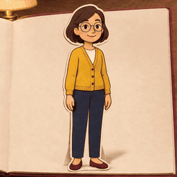
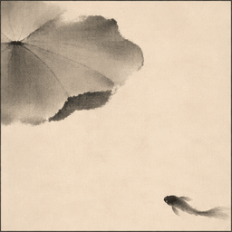
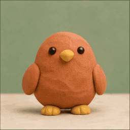
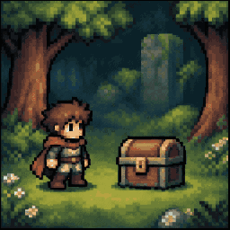
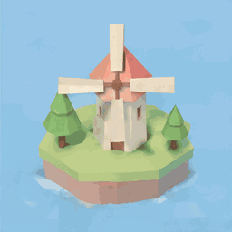
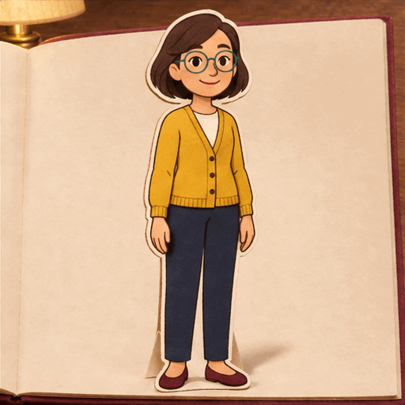
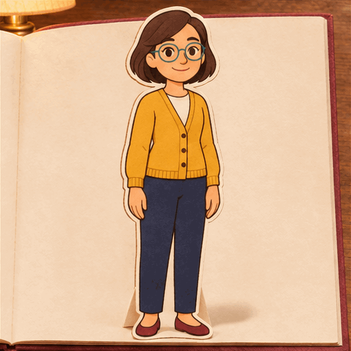

# Codex GIF Video · 调用 GPT Image 2.6 原生生成长 GIF 与 GIF 短视频的 Agent Skill

给一段**口播稿、分镜或动作描述**，这个 Skill 可以通过 **OpenAI GPT API 调用 `GPT Image 2.6` 的原生 GIF 生成能力**（或使用 Codex 原生 GIF 工具），直接生成多帧动态画面，并按你的需要导出为**单镜头短 GIF**、**多镜头拼接的长 GIF**，或**无声 MP4（GIF 短视频）**。

很多人做视频、写推文或用 AI 剪辑工具时卡在动画素材上：用传统视频大模型抽卡又慢又贵，人物跨镜头容易变脸，画面还经常莫名其妙崩出乱码字幕；纯靠代码写动画又画不出手绘绘本、黏土、水墨或复古卡通的具象角色表演。

这个 Skill 专门解决这件事：
- **真·原生 GIF 生成**：直接调用 OpenAI 官方 Image API 的 `GPT Image 2.6`（`gpt-image-2.6-sunburst` / `gpt-image-2.6-flare`，指定 `output_format=gif`）直接输出原生多帧动图，不是拿静态图硬凑 PPT。
- **长 GIF / GIF 视频自由选**：单镜头生成 2–16 帧原生动图；需要更长内容时，自动拆成多个连续镜头，按原速无缝串接成**一个完整长 GIF** 或导出为**静音 MP4（GIF 视频）**。
- **内置 69 种画风 + 跨镜头锁人物**：自带 **69 种内置视觉风格**，支持先生成一张人物主参考图并跨镜头复用，锁住同一个角色、脸型和衣服配色。
- **可与 Hypit 等热门 AI 剪辑 Skill 混搭成片**：全程**不加字幕、不加水印、不加配乐或配音**，交付最干净的纯画面素材——既能直接发 X（Twitter）或拖进剪映，也能直接作为 **[Hypit](https://github.com/hypit-ai/hypit)**、**[Lemo-Opuscar](https://github.com/lemomo-ai/lemo-opuscar)**、**[Huashu-Art-Motion](https://github.com/alchaincyf/huashu-art-motion)**、**[Remotion](https://github.com/remotion-dev/remotion)** 等热门 AI 视频/剪辑仓库的**上游动画素材源（Visual Clips / B-roll）**混合使用。

> [!TIP]
> 🎁 扫码关注公众号「欧八同学」，免费领取 AI 案例与 Skill《大厂产品AI经验编程 200 套》→ [去扫码](#author)

[9 种动图示例](#demo) · [4 大适用场景](#use-cases) · [搭配 Hypit 等剪辑 Skill](#ecosystem) · [安装与 API 配置](#install) · [长 GIF 与视频导出](#formats) · [常见问题 FAQ](#faq) · [69 种风格与致谢](#credits)

<a id="demo"></a>

## 先看 9 种风格实测动图

从 **69 种内置风格**中挑了 9 种代表画风，先看画面材质和动作效果。下方动图均由本 Skill 通过官方 OpenAI GPT Image 2.6 API 原生生成（虚构演示素材，画面无字幕、无水印；点击动图可查看未经改动的原始 GIF）：

<table>
<tr>
<td align="center" width="33%"><strong>纸片立体书</strong><br><a href="codex-gif-video/assets/samples/paper-wave.gif"></a><br><sub>儿童绘本 · 人物讲解</sub></td>
<td align="center" width="33%"><strong>水彩笔刷</strong><br><a href="assets/style-gallery/originals/watercolor.gif"></a><br><sub>自然科普 · 观察笔记</sub></td>
<td align="center" width="33%"><strong>中国水墨</strong><br><a href="assets/style-gallery/originals/ink-wash.gif"></a><br><sub>东方意境 · 国风故事</sub></td>
</tr>
<tr>
<td align="center" width="33%"><strong>厚涂油画</strong><br><a href="assets/style-gallery/originals/impasto.gif"></a><br><sub>情绪短片 · 治愈插画</sub></td>
<td align="center" width="33%"><strong>黏土微缩</strong><br><a href="assets/style-gallery/originals/clay.gif"></a><br><sub>定格动画感 · 萌系绘本</sub></td>
<td align="center" width="33%"><strong>16-bit 像素 RPG</strong><br><a href="assets/style-gallery/originals/pixel-rpg.gif"></a><br><sub>游戏感表达 · X 爆款动图</sub></td>
</tr>
<tr>
<td align="center" width="33%"><strong>低多边形等距</strong><br><a href="assets/style-gallery/originals/lowpoly-island.gif"></a><br><sub>产品概念 · 微缩世界</sub></td>
<td align="center" width="33%"><strong>蓝图 / 工程制图</strong><br><a href="assets/style-gallery/originals/blueprint.gif"></a><br><sub>硬核科普 · 结构拆解</sub></td>
<td align="center" width="33%"><strong>50s 复古卡通</strong><br><a href="assets/style-gallery/originals/midcentury-toon.gif"></a><br><sub>口播配图 · 操作说明</sub></td>
</tr>
</table>

每段 2.4 秒。表格内为 256px 轻量预览，点击可查看原始 GIF。小样目前仅针对选中的 9 种风格做了生成实测；跨镜头连续动作与人物一致性仍需按具体任务复核。[查看全部 69 种内置风格目录](codex-gif-video/references/style-index.md) · [小样来源与参数](assets/style-gallery/gallery.json)。

<details>
<summary>👉 点开看：同一个人物、同一种画风，跨镜头做两个连续动作</summary>

同一位 AI 生成的虚构角色，锁定同一套「纸片立体书」画风与服装配色，分别生成两个不同动作镜头：

| 镜头 1：招手打招呼 | 镜头 2：指向旁边讲解 |
| --- | --- |
|  |  |

每段 2.4 秒、12 帧。已完成 24 帧静态身份一致性核对（正常速度连续播放与服务端自报模型字段仍保留待核验记录，详见 [人物小样检查结果](codex-gif-video/assets/samples/identity-results.json)）。

</details>

<a id="use-cases"></a>

## 适合拿来做什么？（5 个高频场景）

只要你需要**画风统一、人物稳定、画面干净无乱码字**的动态素材，都可以直接用它产出：

| 适用场景 | 为什么适合用它做 | 推荐内置风格（69 种可选） | 推荐导出格式 |
| --- | --- | --- | --- |
| **1. X（Twitter）爆款 GIF 短视频** | 最近在 X 上发「GIF 视频 / 长动图」非常火：信息流里**免点开自动循环播放**，而且手机端在 X 上**长按就能直接复制链接或保存转发**，传播裂变极快。用它可以把观点、教程或小剧场拆成多镜头，一键拼成完整动图。 | `midcentury-toon`（50s 复古卡通）<br>`pixel-rpg`（16-bit 像素）<br>`iso-infographic`（等距信息图）<br>`rubber-hose`（30s 橡皮管卡通） | **长 GIF**（`.gif`）或 **静音 MP4**（`.mp4`） |
| **2. 口播视频动画素材（B-roll）** | 做抖音、小红书、B 站、视频号或 YouTube 口播时，直接把口播逐字稿喂给它，自动按语义拆成一段段**无字幕、无配音的纯画面动作素材**，拖进剪映 / PR 就能直接对齐人声加字幕，再也不用忍受 AI 视频里的鬼画符乱码字。 | `whiteboard`（白板讲解）<br>`urban-sketch`（钢笔淡彩）<br>`flat`（通用扁平插画）<br>`cel-anime-80s`（80s 赛璐璐动画） | **静音 MP4**（9:16 竖屏或 16:9 横屏） |
| **3. 儿童绘本读物 / 睡前故事** | 做儿童启蒙绘本、小红书绘本号或有声读物，最怕“每一页小主角长得不一样”。它可以先生成一张主角定妆照（主参考图），后续每一页都带着同一张参考图生成动作，保证小主人公长相和衣服跨页不跑偏。 | `crayon-book`（蜡笔儿童绘本）<br>`paper-popup`（纸片立体书）<br>`clay`（黏土微缩）<br>`isometric-picture-book`（等距绘本） | **单镜短 GIF**（按页插图）或 **长 GIF / MP4** |
| **4. 知识科普 / 产品原理拆解** | 写公众号长文、技术博客、飞书文档或做演示课件时，一句话生成部件拆解、流程运转或数据变化的动态示意图，比静态截图直观十倍，体积又比完整视频轻得多。 | `blueprint`（蓝图工程制图）<br>`lowpoly-island`（低多边形等距）<br>`watercolor`（水彩笔刷）<br>`ink-wash`（中国水墨） | **单镜短 GIF** 或 **长 GIF** |
| **5. 给 Hypit 等 AI 剪辑 Skill 供片** | 热门 AI 视频编导/剪辑 Skill 擅长做时间线对齐、配音字幕和代码组件动画，但缺少手绘/绘本/黏土等具象角色动画镜头。用本 Skill 生成干净无字的 `.mp4` / `.gif`，直接喂给下游剪辑 Skill 合成完整成片。 | 全部 **69 种内置风格**按需调用 | **静音 MP4** + **原始短 GIF 清单** |

<a id="ecosystem"></a>

## 🔗 与 Hypit 等热门 AI 剪辑 Skill 混合使用（外挂动画素材源）

如果你正在使用 GitHub 上热门的 AI 视频编导、代码动画或自动剪辑 Skill，**`codex-gif-video` 可以直接作为它们的「外挂原生动画素材库」协同工作**。

为什么需要混合使用？
代码渲染类工具（Canvas / SVG / React / SVML）非常擅长做**精准排版、数据图表、字幕卡点与转场编排**，但很难用代码直接画出“水彩银杏叶晕染”、“黏土小鸟展翅”、“纸片立体书角色招手”这类有肌理、有具象角色表演的画面；而本 Skill 恰好只生成**不带字幕、不带音轨、按口播语义拆好镜头的纯净 `.mp4` / `.gif` 视觉资产**，放进下游时间线里完全不会和下游的字幕、配音打架：

| 下游热门 AI 视频 / 剪辑项目 | 混合使用方式（上游供片 → 下游成片） | 解决什么痛点 |
| --- | --- | --- |
| **[Hypit (`hypit-ai/hypit`)](https://github.com/hypit-ai/hypit)**<br><sub>AI 视频导演与 SVML/SVS 成片引擎</sub> | 先用 `$codex-gif-video` 将口播稿中需要具象表演或手绘插画的段落生成无字幕静音 `.mp4`（或 `.gif`），再交给 `$hypit` 作为 `Visual Clip` 编入 `SVML` 时间线，与口播主轨（A-roll / Audio Clip）、独立字幕包（Caption）和动态组件按语义锚点精准合成。 | 给 Hypit 的结构化视频生产补充 **69 种手绘/绘本/复古卡通/像素风的原生动态镜头**，且画面干净无字，不破坏 Hypit 的独立字幕层。 |
| **[Lemo-Opuscar (`lemomo-ai/lemo-opuscar`)](https://github.com/lemomo-ai/lemo-opuscar)**<br><sub>AI 动画导演与多风格长片项目</sub> | 两套工具共享同一套视觉美学体系。当你需要用模型直接产出具象人物或手绘肌理的原生动图镜头时，用 `$codex-gif-video` 调用 GPT Image 2.6 生成素材，与代码渲染段落混剪。 | 在保留画风与配色规范的同时，提供了一条**免写绘制代码、直接由 GPT Image 2.6 原生出动图**的互补路径。 |
| **[Huashu-Art-Motion (`alchaincyf/huashu-art-motion`)](https://github.com/alchaincyf/huashu-art-motion)**<br><sub>花叔艺术与解说视频动画 Skill</sub> | 在制作口播解说片或产品发布片时，用 `$codex-gif-video` 生成锁定人物形象的连续动作片段或特殊材质空镜（水墨、厚涂油画、蓝图拆解），作为解说动画中的插图镜头。 | 丰富解说视频中的具象角色表演与艺术材质画面，省去逐帧修图。 |
| **[Remotion (`remotion-dev/remotion`)](https://github.com/remotion-dev/remotion) / 剪映工作流**<br><sub>编程式视频框架与主流剪辑软件</sub> | 将本 Skill 导出的静音 `.mp4` 或长 `.gif` 直接作为 `<OffthreadVideo>` / `<Gif>` 组件素材引入 Remotion，或拖入剪映时间线一键识别人声加字幕。 | 拿到手就是调好画幅（16:9 / 9:16 / 1:1）、固定时长且无乱码水印的干净 B-roll。 |

**💡 组合调用示例（`codex-gif-video` × `hypit` 联动成片）：**

```text
第一步（生成纯净动画素材）：
使用 $codex-gif-video，按这段口播拆成 3 个镜头，用 50s 复古卡通风格（midcentury-toon）生成 16:9 的无字幕静音 MP4 素材，并保留每个镜头的分镜清单。

第二步（交给 Hypit 编排配音、字幕与成片）：
使用 $hypit，把刚才生成的 3 段无字幕 MP4 素材作为 Visual Clips 引入项目，对齐口播音频的时间锚点，叠加可编辑的独立字幕层（Caption）和片头转场，合成为最终带配音字幕的完整视频。
```

## 它是怎么跑起来的？（4 步工作流）

1. **输入需求或口播稿**：你给出动作描述、分镜脚本或一段口播文字，指定画幅比例（16:9 / 9:16 / 1:1）、目标时长和想要的格式（GIF 或 MP4）。
2. **自动选风格 & 锁死人物**：Agent 从 **69 种内置风格**中匹配最适合的画风（也可直接点名风格）；如果涉及连续镜头里的同一个角色，先生成或绑定一张静态人物主参考图（`reference`），锁住五官、发型和穿搭颜色。
3. **调用 GPT Image 2.6 原生生成 GIF**：通过你配置的 **OpenAI 官方 Image API**（调用 `gpt-image-2.6-sunburst` 或 `gpt-image-2.6-flare`，开启原生 `output_format=gif`）或 Codex 会话原生 GIF 工具，逐镜头生成多帧动态 GIF，并自动校验帧数、尺寸、画面变化与无文字干扰。
4. **一键合成长 GIF 或静音 MP4**：你可以直接拿走每个镜头的原始短 GIF，也可以让它把多个镜头按原速无缝串接成**一个长 GIF**，或编码成**静音 H.264 MP4 视频**。

<a id="install"></a>

## 安装与快速上手

### 1. 安装 Skill 到你的 Agent

把仓库里的 `codex-gif-video` 目录复制或软链接到 Codex / Claude Code 的技能目录即可：

```bash
git clone https://github.com/ouxxyy/codex-gif-video.git
cd codex-gif-video
mkdir -p ~/.codex/skills
cp -R codex-gif-video ~/.codex/skills/codex-gif-video
```

如果你平时用 Claude Code，也可以同样放进 `~/.claude/skills/codex-gif-video`。重新打开会话后，直接用 `$codex-gif-video`（或点名技能）调用。

### 2. 安装本地合成与检查依赖

本地镜头规划、质量检查与长 GIF / MP4 导出需要 Python 3.10+ 和 Pillow；如果要导出 MP4 视频，还需要装一下 FFmpeg。macOS（含 Apple Silicon）执行：

```bash
python3 -m venv .venv
source .venv/bin/activate
python3 -m pip install -r requirements.txt
brew install ffmpeg  # 需要导出 MP4 视频格式时安装
```

### 3. 配置生成入口（支持 GPT API 调用 Image 2.6 或 Codex 原生工具）

本 Skill 支持两种原生 GIF 生成方式（二选一）：

- **方式 A：通过 OpenAI 官方 GPT API 调用 `GPT Image 2.6`（推荐，稳定可控）**
  在项目根目录创建权限为 `0600` 的 `.env.local` 文件，填入你的 OpenAI API Key（需账户已开通 `gpt-image-2.6-sunburst` 或 `gpt-image-2.6-flare` 的原生 GIF 权限）：
  ```bash
  cp .env.example .env.local
  chmod 600 .env.local
  # 编辑 .env.local 填入 OPENAI_API_KEY=sk-...
  python3 codex-gif-video/scripts/official_api.py status --env-file .env.local
  ```
- **方式 B：直接使用 Codex 会话内置的原生 GIF 工具**
  如果当前 Codex 环境本身已暴露带 `gif` 参数的原生图像工具，可免配额外 API Key 直接调用。

> 详细配置说明见：[官方 GPT Image 2.6 API 模式说明](codex-gif-video/references/official-api.md) · [Codex 原生入口诊断](codex-gif-video/references/native-entry.md)。本仓库不附带 API 密钥，API 调用费用由 OpenAI 官方按量收取。

### 4. 复制就能用的 3 个独立示例指令

**示例 1：做一条发在 X（Twitter）上的长 GIF 短视频**
```text
使用 $codex-gif-video，帮我做一段适合发 X 的 9 秒长 GIF：
主题是“打工人周一早上靠三杯咖啡续命”，拆成 3 个连续镜头（趴在桌上 -> 端起大杯美式猛喝 -> 眼神发光疯狂敲键盘）。
用 50s 复古卡通风格（midcentury-toon），保持同一个人物形象，16:9，最后合成一个长 GIF。
```

**示例 2：把口播稿做成剪映 / Hypit 可用的无字幕动画素材（MP4）**
```text
使用 $codex-gif-video，把下面这段口播做成 9:16 竖屏静音 MP4 视频素材，总长 12 秒，拆成 4 个镜头：
“很多人以为存不下钱是因为拿得少，其实是因为账单像漏水的水管，悄无声息把水池排空了。”
用钢笔淡彩风格（urban-sketch），全程不要出现任何字幕或文字。
```

**示例 3：做一套人物一致的儿童绘本动图**
```text
使用 $codex-gif-video，做一个穿黄色雨衣的小女孩在森林里散步的儿童绘本动图：
镜头 1 是小女孩蹲下看发光的蘑菇，镜头 2 是小女孩抬头向小鸟招手。
用蜡笔儿童绘本风格（crayon-book），1:1 方形，每段 2.4 秒，先生成主参考图锁住小女孩形象，分别保留短 GIF 并额外拼一个长 GIF。
```

<a id="formats"></a>

## 输出格式怎么选：短 GIF、长 GIF 还是 MP4 视频？

你可以根据发布平台或下游剪辑工具随时指定导出格式：

| 你想要什么结果 | 直接怎么跟 Agent 说 | 最终交付的文件 | 适合发哪里 / 怎么用 |
| --- | --- | --- | --- |
| **分镜头独立动图** | “每个镜头分别保存成 GIF” | 每个镜头的原始 `.gif` + 镜头清单 | 嵌入公众号文章、飞书文档、Notion、儿童绘本单页 |
| **一个完整长 GIF** | “把这几个镜头按顺序拼成一个 12 秒长 GIF” | 单个合并后的长 `.gif`（原速播放） | 发 **X（Twitter）动图推文**（长按即可复制链接）、GitHub README 演示 |
| **无声 GIF 视频（MP4）** | “导出成 15 秒 MP4 视频素材” | 单个静音 `.mp4`（H.264，无字幕无音轨） | 喂给 **Hypit / Remotion**、导入 **剪映 / Premiere** 当口播 B-roll，或发小红书 / 抖音 / X |
| **长 GIF 和 MP4 都要** | “长 GIF 和 MP4 视频各导出一份” | 同一组镜头同时导出 `.gif` 与 `.mp4` | 一次生成、不重复花钱，同时发推文和进剪辑工作流 |

> **关于长 GIF 与视频合成的真实说明**：单次 API 调用生成的是 2–16 帧的原生短 GIF；长 GIF 和 MP4 是把多个已经生成的原生短镜头按原速顺序拼接出来，不会靠慢放、循环重复、停帧或插帧来假装“单镜超长生成”。如果总时长较长、GIF 体积偏大，优先推荐同时导出 MP4。[查看导出细节与命令](codex-gif-video/references/movie.md)。

<a id="faq"></a>

## 常见问题（FAQ）

### 1. 它是怎么生成 GIF 的？跟可灵、即梦、Sora 这类 AI 视频模型有什么区别？
它不是调用文生视频大模型生成几百帧的写实长视频，而是通过 **OpenAI 官方 Image API 调用 `GPT Image 2.6`（`gpt-image-2.6-sunburst` / `gpt-image-2.6-flare`）的原生 GIF 输出能力（`output_format=gif`）**。
它的优势是：**69 种画风控制极其扎实（绘本、像素、水彩、复古卡通、工程蓝图等质感远比通用视频模型稳定）、天生适合做几秒一个动作的节奏感动图、不会乱加崩坏的字幕水印**，而且支持把多个短镜头拼成一条长 GIF 或轻量 MP4。

### 2. 内置的 69 种风格都包含哪些类型？怎么挑選？
一共内置了 **69 种可直接调用的风格**，涵盖手绘与绘画（蜡笔儿童绘本、水彩笔刷、中国水墨、厚涂油画、钢笔淡彩、白板讲解等）、材质与 3D（纸片立体书、黏土微缩、积木玩具、低多边形等距、玻璃产品等）、卡通与动画（50s 扁平卡通、30s 橡皮管卡通、80s 赛璐璐动画等）、游戏（16-bit 像素 RPG、HD-2D 等）以及图形与信息拆解（工程蓝图、等距信息图、Risograph 孔版印刷等）。
你可以不指定风格让 Agent 根据口播内容自动推荐，也可以通过 `style_router.py list` 或查看 [69 种风格完整目录](codex-gif-video/references/style-index.md) 直接点名。

### 3. 为什么说它很适合发 X（Twitter）短视频？
最近在 X 上，用 GIF 或无声循环短片发教程、产品亮点和视觉故事非常火：一方面用户在时间线里刷到就能直接看，不需要开声音；另一方面，在 X 手机端**长按 GIF 就能直接复制链接或保存转发**，互动和二次传播率比普通外链视频高很多。用这个 Skill 可以直接把 3–5 个分镜拼成一个长 GIF 或同源 MP4，专门适配这种玩法。

### 4. 它可以和 Hypit、Remotion 等其他热门 AI 视频剪辑 Skill 一起用吗？
非常适合。很多热门 AI 视频成片 Skill（如 [Hypit](https://github.com/hypit-ai/hypit)、[Huashu-Art-Motion](https://github.com/alchaincyf/huashu-art-motion)、[Remotion](https://github.com/remotion-dev/remotion)）擅长做多轨时间线编排、配音对口型、动态字幕与代码几何动画；而 `codex-gif-video` 专门负责产出**画面干净、无字幕、无音轨的 69 种风格原生动画镜头（`.mp4` / `.gif`）**。你只需要先用本 Skill 把分镜动画生成好，再把导出的 `.mp4` 交给下游剪辑 Skill 叠加配音和字幕，就能做出既有手绘/绘本角色表演、又有专业成片包装的视频。

### 5. 多个镜头怎么保证是同一个人物？会变脸或换衣服吗？
当你需要多镜头出现同一个角色时，Skill 会先用同一模型生成一张**静态人物主参考图（Master Reference）**，并在固定同一画风（`style_lock`）的前提下，把这张主参考图传给后续每一个镜头的 `images/edits` 接口。[人物一致性测试记录](codex-gif-video/references/character-testing.md) 显示：在同一风格下（例如纸片立体书），跨动作能较好保持人物形象；但如果中途强行跨风格切换（比如从纸艺切到复古卡通），服装颜色仍可能发生漂移，因此默认建议同一条片子锁定同一种风格。

## 使用前需要了解的真实边界

- **风格覆盖与实测范围**：[69 种风格目录](codex-gif-video/references/style-index.md) 已全部完成原生 GIF 提示词与禁忌规则适配，但目前公开小样只对其中 9 种风格与 2 组人物动作做过实际渲染与逐帧核验，目录收录不等于 69 种全部做过渲染测试。
- **帧数与画幅默认参数**：单镜头规划为 2–16 帧，适合表达清晰、干脆的动作变化；默认尺寸为 16:9（512×288）、9:16（288×512）、1:1（512×512），也可按服务支持的 16 倍数像素显式指定。
- **防刷爆预算保护**：为防止 Agent 循环重试烧光 API 额度，默认同一批次最多允许 8 次 GIF 生成请求和 3 次参考图请求（失败与超时也计入，需显式指令才重试）。
- **系统与环境**：本地规划、检查与导出脚本已在 macOS（Apple Silicon）验证；因使用 `fcntl` 文件锁，暂不直接支持原生 Windows（Windows 用户建议使用 WSL）。

## 开发与本地自检（不消耗 API 额度）

以下命令在仓库根目录、激活 Python 虚拟环境后即可离线运行，用于验证规则路由、时长计算、长 GIF 串接与 MP4 导出逻辑，不触发联网计费：

```bash
python3 -m unittest discover -s tests -v
python3 codex-gif-video/scripts/native_gif.py prepare \
  --request examples/shot.json --out runs/example-plan
python3 codex-gif-video/scripts/package_skill.py --out dist/codex-gif-video.skill
```

## English Overview

**Codex GIF Video** (`codex-gif-video`) is an Agent Skill for Codex and Claude Code that generates **native animated GIFs, concatenated long GIFs, and silent MP4 videos (GIF videos)** from action briefs, storyboards, or talking-head scripts.

- **Powered by OpenAI GPT Image 2.6 Native GIF API**: Calls the official OpenAI Images API (`gpt-image-2.6-sunburst` / `gpt-image-2.6-flare` with `output_format=gif`) or an enabled Codex native GIF tool to render genuine multi-frame animations—not static slide decks or code-drawn SVG loops.
- **69 Built-in Visual Styles**: Includes **69 curated visual styles**, covering crayon picture books, 3D paper pop-ups, watercolor, Chinese ink wash, impasto oil painting, 16-bit pixel RPG, isometric low-poly, engineering blueprints, and 1950s midcentury cartoons.
- **Character Consistency Across Shots**: Generates and locks a master character reference image (`images/edits`) so the same protagonist keeps their face and outfit across multi-shot sequences.
- **Seamless Visual Asset Provider for Popular AI Video Editing Skills**: Outputs clean, subtitle-free, watermark-free silent `.mp4` and `.gif` clips that plug directly into downstream AI video production and editing skills like **[Hypit (`hypit-ai/hypit`)](https://github.com/hypit-ai/hypit)** (as `Visual Clips` in `SVML` timelines), **[Lemo-Opuscar (`lemomo-ai/lemo-opuscar`)](https://github.com/lemomo-ai/lemo-opuscar)**, **[Huashu-Art-Motion (`alchaincyf/huashu-art-motion`)](https://github.com/alchaincyf/huashu-art-motion)**, and **[Remotion (`remotion-dev/remotion`)](https://github.com/remotion-dev/remotion)**.
- **Built for 5 High-Frequency Scenarios**:
  1. **Viral X (Twitter) GIF Videos**: Multi-shot long GIFs and silent MP4s that auto-play in feeds and let mobile users long-press to copy links and repost.
  2. **Talking-Head B-Roll Assets**: Clean, subtitle-free silent animations from voiceover scripts, ready for CapCut / Premiere.
  3. **Children's Picture Books & Storybooks**: Consistent characters and warm hand-drawn textures (`crayon-book`, `paper-popup`, `clay`) across story pages.
  4. **Product & Science Explainers**: Dynamic diagrams and teardowns (`blueprint`, `iso-infographic`, `whiteboard`) for blogs, docs, and slides.
  5. **Upstream Animation Footage for AI Video Editors**: Supplies character-driven and hand-crafted visual clips to Hypit, Remotion, and other AI editing workflows.

<a id="credits"></a>

## 69 种风格来源与致谢

**特别感谢 [Lemomo（@lemomo-ai）](https://github.com/lemomo-ai) 创作并开源 [Lemo-Opuscar](https://github.com/lemomo-ai/lemo-opuscar)。本项目内置的 69 种视觉风格，核心材质、配色、人物表现、动作与镜头语言指南深度参考并改编自该仓库的开源积累，并在此基础上补充了通用扁平、纸艺与黏土基础预设。**

这里固定引用上游提交 `9eb7739a0fca4c6990fe966cb8b87b1930f7193a` 的风格指南与对应元数据，并将其从“代码生成长片”适配为“GPT Image 2.6 原生 GIF 画面约束”（剔除了上游针对字幕、配音与代码渲染引擎的指令）。未打包上游演示影片、音乐、字体或角色资产。

原始资料及 LemoLab 版权声明随包完整保留，详见 [来源说明](codex-gif-video/CREDITS.md)、[上游 MIT 许可证](codex-gif-video/references/lemo-source/LICENSE) 和 [固定版本记录](codex-gif-video/references/lemo-source/provenance.json)。非常推荐大家去原仓库欣赏完整作品并给原作者点 Star！

## 相关项目与生态联动

- **互补 AI 视频剪辑与分镜生态**：
  - [Hypit (`hypit-ai/hypit`)](https://github.com/hypit-ai/hypit)：基于 SVML 的 AI 视频编导与成片 Skill，可将本仓库生成的无字幕 MP4 / GIF 作为 `Visual Clips` 与配音字幕合成完整视频。
  - [Lemo-Opuscar (`lemomo-ai/lemo-opuscar`)](https://github.com/lemomo-ai/lemo-opuscar)：本仓库风格体系的重要灵感与指南来源，使用代码引擎导演多风格动画长片。
  - [Huashu-Art-Motion (`alchaincyf/huashu-art-motion`)](https://github.com/alchaincyf/huashu-art-motion)：花叔开源的艺术与口播解说视频动画 Skill，可与本仓库生成的原生角色动图素材混剪。
  - [Storyboard Scavenger（AI 视频分镜与提示词 Skill）](https://github.com/ouxxyy/storyboard-scavenger)：需要可灵 Kling / 即梦 Seedance / Veo / Sora 写实长视频分镜时用这个。
- **作者更多作品**：
  - [重拍画册 · 旅行照片艺术画册 Skill](https://github.com/ouxxyy/travel-art-album-skill)：把静态照片做成带艺术风格的离线翻页相册。
  - [欧八同学 AI Skills 与工具合集](https://github.com/ouxxyy/ouba-classmate)：一行命令安装全部原创 AI Skills。
  - 全部项目与作者主页：[github.com/ouxxyy](https://github.com/ouxxyy)

<a id="author"></a>

## 作者

作者全平台同名：**欧八同学**。9 年网易、搜狐大厂产品，跳槽换行 7 次，涨薪 10 倍。

[联系我](https://albertou.redboook.cn/)

- 微信公众号：扫码关注，免费领取 AI 案例与 Skill《大厂产品AI经验编程 200 套》
- 抖音：[搜索“欧八同学”](https://www.douyin.com/search/%E6%AC%A7%E5%85%AB%E5%90%8C%E5%AD%A6)
- 小红书：[搜索“欧八同学”](https://www.xiaohongshu.com/search_result?keyword=%E6%AC%A7%E5%85%AB%E5%90%8C%E5%AD%A6)
- X：[搜索“欧八同学”](https://x.com/search?q=%E6%AC%A7%E5%85%AB%E5%90%8C%E5%AD%A6&src=typed_query)

<p align="center"></p>
<p align="center"><sub>扫码关注「欧八同学」，免费领取《大厂产品AI经验编程 200 套》</sub></p>

如果这个 Skill 帮你省下了找配图、抽卡做动图的时间，欢迎在右上角点个 **★ Star** 收藏。遇到问题可提交 [Issue](https://github.com/ouxxyy/codex-gif-video/issues)，附上脱敏命令、报错与最小复现步骤；请勿上传 API 密钥或私人照片。

## 许可证

项目代码与原创文档采用 [MIT 许可证](LICENSE)。上游风格文档保留各自的 MIT 声明；README 中的虚构角色与风景 GIF 均为 AI 生成演示素材，不代表上游作者作品。二维码仅用于作者标识与关注入口。
